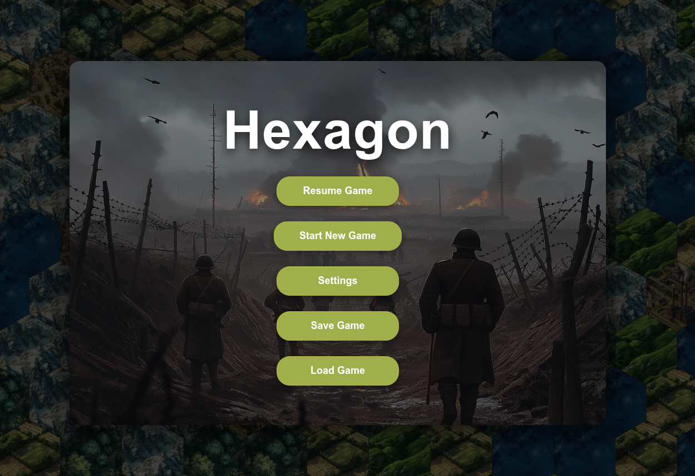
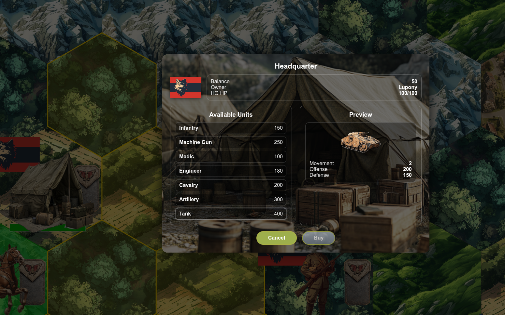

# Hexagon
**Turn-based Hex Strategy Game (Browser)**

Hexagon is a turn-based strategy game played on a hexagonal grid, inspired by classic tactical war games.  
The focus is on positioning, terrain effects, unit roles, and deliberate decision-making rather than fast-paced action.

The project started as a C++/Qt desktop game and is currently being evolved into a modern browser-based version.

👉 **The latest playable release is always available at:**  
**https://www.buening.eu**

---

## Screenshots

### Main Menu

  

### Gameplay Overview

  

### Headquarter – Buy Units Dialog

  

---

## Gameplay Overview

- **Turn-based gameplay** on a hexagonal map
- **Two factions** taking alternating turns
- **Multiple unit types**, each with a clear battlefield role
- **Terrain-based movement and defense**
- **Combat with preview and outcome calculation**
- **Economy system** based on cities and industry
- **Single-player with AI opponent**

---

## Core Mechanics

### Hex Map
- True hex-grid movement and distance calculation
- A* pathfinding for unit movement
- Terrain affects:
  - Movement cost
  - Defensive value
- Units block tiles and influence pathfinding

### Units
Available unit types include:
- Infantry
- Machine Gun
- Medic
- Engineer
- Cavalry
- Artillery
- Tank
- Headquarter (HQ)

Each unit has:
- Movement points per turn
- Attack range
- Offensive and defensive values
- Experience and health state
- Limited actions per turn

---

## Combat System

- Turn-based combat with visual preview
- Damage depends on:
  - Unit type
  - Experience
  - Terrain defense
- Attacking consumes the unit’s action for the turn
- Units can be destroyed or forced to retreat

---

## Economy

- **Cities** generate income each round
- **Industry tiles** provide additional resources
- New units can be purchased at the Headquarter
- AI considers available resources when buying units

---

## Artificial Intelligence

The AI is state-based and assigns roles dynamically:

- **ATTACK** – engage enemy units
- **CAPTURE** – secure cities and industry
- **DEFEND / GUARD** – protect the headquarter
- **RETREAT** – pull back damaged units
- **SUPPORT** – heal units if a medic is available

The goal is not perfect play, but **believable and readable tactical behavior**.

### Difficulty levels

The levels differ in how the AI plays (see `aiProfiles` in `src/core/systems/aiSystem.ts`):

- **Easy** – sometimes picks a random attack instead of the best one, often does not advance, ignores danger, does not focus fire, buys from a fixed list and retreats late.
- **Normal** – full tactics: move-and-attack, target scoring, threat-aware positioning, focus fire and counter-buying.
- **Hard** – like Normal, plus defending the own headquarter and a 1.5× income bonus.

In simulations Normal wins about 79 % of games against Easy and Hard about 59 % against Normal.

### Testing and balancing the AI

Random numbers in map generation, start units and combat come from an injectable generator (`src/core/rng.ts`), so games can be reproduced with a seed.

- `npm test` runs the unit tests in `tests/`.
- `npm run simulate -- --games 100 --seed 1` lets two AIs play against each other headlessly and prints win rates, average game length and AI time. Use `--a` and `--b` to pick the difficulty of each side (`easy`, `normal`, `hard`), `--a-income` / `--a-set threatWeight=1.5` (and the same for `--b`) to override single profile settings, and `npm run simulate -- --help` for all options.
- `npm run typecheck:tools` type-checks the tests and the simulation tool.

---

## Features

- Random map generation
- Map editor mode
- Save & load:
  - Games (`.game`)
  - Maps (`.map`)
- Zoomable map view
- Visual overlays for movement and attacks

---

## Project Status

**Current state:**
- ✔ Fully playable
- ✔ Single-player vs AI
- ✔ Map editor
- ✔ Save / load system

**Planned / in progress:**
- Balance improvements
- Additional unit types
- Smarter AI priorities
- UI polish and animations
- Sound and visual feedback
- Multiplayer (long-term)

---

## Play the Game

You can always play the **latest stable version directly in your browser**:

👉 **https://www.buening.eu**

No installation required.

---

## License

Hexagon is released under the  
**GNU General Public License v3 (GPL-3.0)**.

You are free to use, modify, and redistribute the project under the same license terms.

---

## Motivation

Hexagon is a hobby and learning project focusing on:
- Game architecture
- Hex-grid algorithms
- Tactical AI design
- UI/UX for strategy games
- Porting from desktop (C++/Qt) to web technologies

Feedback, ideas, and contributions are very welcome.
